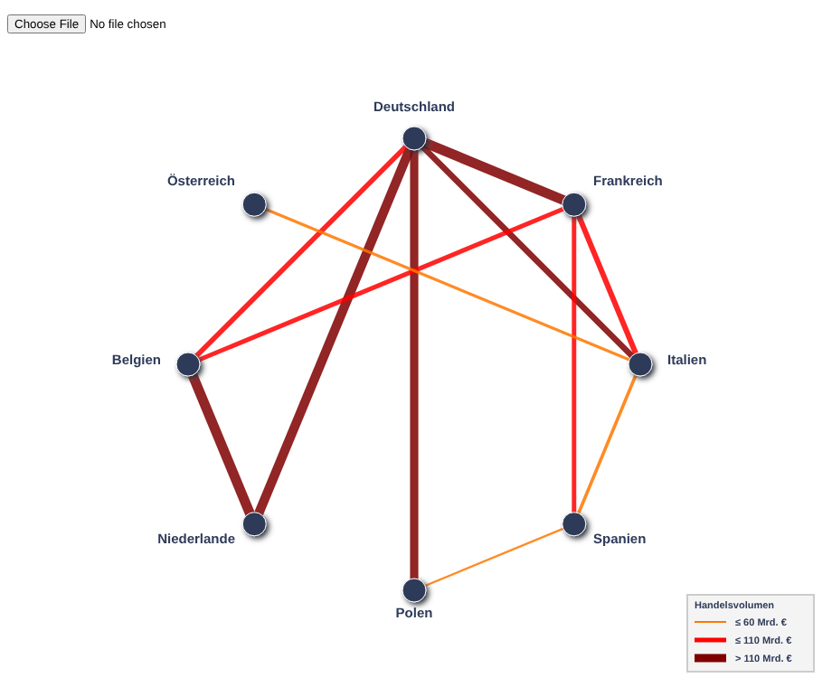
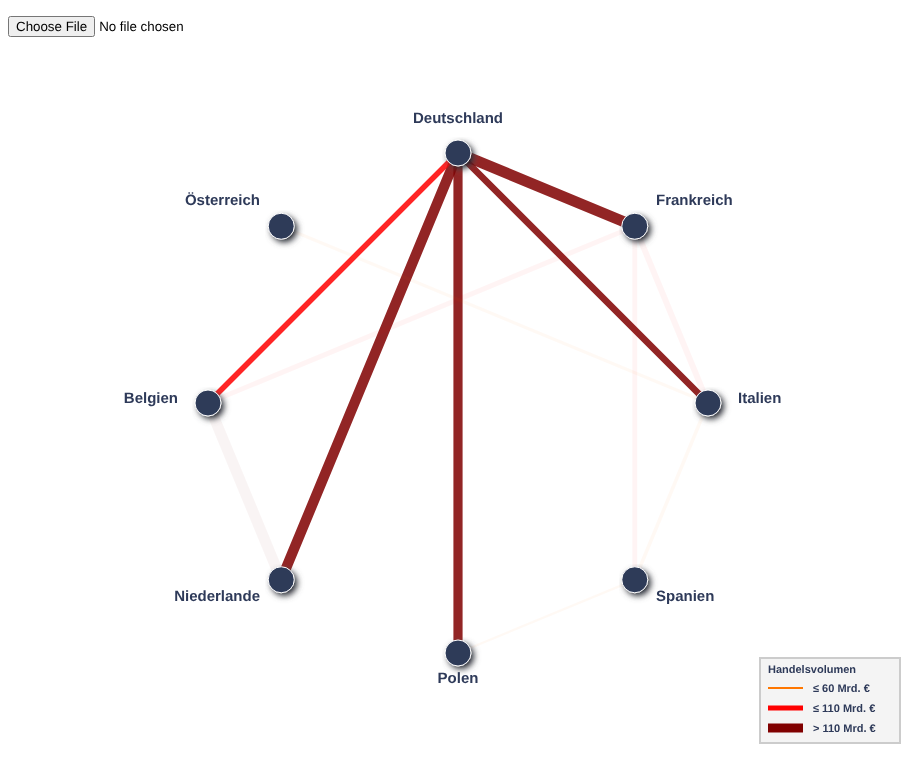

# Radial Convergences – Handelsbeziehungen in Europa

Eine interaktive Visualisierung der Handelsbeziehungen zwischen acht europäischen Ländern im Jahr 2023. Die Länder liegen als Knoten auf einem Kreis, die Verbindungslinien zeigen das Handelsvolumen in Milliarden Euro. Das Diagramm ist komplett in reinem JavaScript und SVG gezeichnet, ohne externe Bibliotheken.

> **Kontext:** Einzelprojekt im Modul **Anwendungsentwicklung**, Hochschule Worms, Sommersemester 2026.



## Ziel

Ein Radial-Convergences-Diagramm ordnet Entitäten gleichmäßig auf einem Kreis an und verbindet sie durch Linien. Es ähnelt einem Netzwerkdiagramm, bleibt durch das feste kreisförmige Layout aber auch bei vielen Verbindungen übersichtlich ([Beschreibung im Data Viz Project](https://datavizproject.com/data-type/radial-convergences/)).

Das Projekt zeigt:

- **Objektorientiertes JavaScript (ES6)** mit drei Klassen, die Datenhaltung und Zeichnen trennen
- **SVG-Erzeugung per DOM** (`createElementNS`) inklusive Filter für Schatten
- **Geometrie mit sin/cos** für die gleichmäßige Verteilung der Knoten auf dem Kreis
- **Datei-Import im Browser** über die FileReader API
- **Interaktion** mit Klick-, Doppelklick- und Hover-Ereignissen

## Funktionen

| Bereich | Inhalt |
|---|---|
| Radiales Layout | Die Knoten werden automatisch gleichmäßig auf einem Kreis verteilt, beginnend oben. Die Beschriftung richtet sich je nach Position links, rechts oder mittig aus. |
| Kanten | Die Linienstärke ist proportional zum Handelsvolumen (1 bis 11 px). Die Farbe zeigt die Größenklasse. |
| Hervorhebung | Ein Klick auf ein Land blendet alle Verbindungen aus, die nicht zu diesem Land gehören. Ein Doppelklick setzt die Ansicht zurück. |
| Tooltip | Beim Überfahren einer Linie erscheint das genaue Volumen, z. B. „Deutschland --> Frankreich : 209 Mrd. €“. |
| Legende | Drei Farbklassen für das Handelsvolumen |
| CSV-Import | Über das Dateifeld oben lässt sich eine eigene CSV-Datei laden. Das Diagramm wird daraus neu aufgebaut. |



*Nach einem Klick auf „Deutschland“ bleiben nur dessen Handelsbeziehungen sichtbar.*

### Farbklassen

| Farbe | Handelsvolumen |
|---|---|
| Orange | bis 60 Mrd. € |
| Hellrot | bis 110 Mrd. € |
| Dunkelrot | über 110 Mrd. € |

## Die Daten

Beim Start zeigt das Diagramm zwölf Handelsbeziehungen aus dem Jahr 2023 (Quellen: [World Bank WITS](https://wits.worldbank.org), Eurostat). Dieselben Werte liegen in `Handelsbeziehungen_2023.csv`:

| Von | Nach | Volumen (Mrd. €) |
|---|---|---|
| Niederlande | Belgien | 210 |
| Deutschland | Frankreich | 209 |
| Deutschland | Niederlande | 195 |
| Deutschland | Polen | 172 |
| Deutschland | Italien | 120 |
| Frankreich | Italien | 105 |
| Deutschland | Belgien | 95 |
| Frankreich | Belgien | 85 |
| Frankreich | Spanien | 83 |
| Italien | Spanien | 55 |
| Italien | Österreich | 48 |
| Spanien | Polen | 30 |

### Eigene Daten laden

Die CSV-Datei braucht eine Kopfzeile und drei Spalten, getrennt durch Semikolon:

```
from;to;volume_bn_EUR
Deutschland;Frankreich;209
Deutschland;Italien;120
```

- Neue Ländernamen in `from` oder `to` werden automatisch als Knoten angelegt.
- Das Volumen muss eine ganze Zahl sein.
- Die Zeilen müssen mit Windows-Zeilenumbrüchen (CRLF) enden, da `build()` an `\r\n` trennt. Mit Excel oder dem Windows-Editor gespeicherte Dateien erfüllen das automatisch.

## Projekt starten

Es wird nur ein Browser benötigt, keine Installation und kein Build-Schritt.

- **Variante 1:** `RadialConvergences.html` per Doppelklick im Browser öffnen.
- **Variante 2:** In Visual Studio Code mit der Erweiterung *Live Server* öffnen (Port 5502 ist in `.vscode/settings.json` eingestellt).
- **Variante 3:** Einen lokalen Webserver starten und **http://localhost:8000/RadialConvergences.html** öffnen:

```bash
python -m http.server 8000
```

## Aufbau des Codes

| Klasse / Datei | Aufgabe |
|---|---|
| `ClassRCD` | Wurzelobjekt des Diagramms: legt das SVG und den Schattenfilter an, verwaltet Knoten und Kanten, liest CSV-Daten (`build()`), steuert die Hervorhebung und zeichnet Diagramm und Legende (`show()`) |
| `ClassNode` | Ein Land: berechnet die Position auf dem Kreis aus dem Winkel, zeichnet Kreis und Beschriftung, reagiert auf Klick und Doppelklick |
| `ClassEdge` | Eine Handelsbeziehung: prüft, ob beide Knoten existieren, berechnet Linienstärke und Farbe, zeigt den Tooltip |
| `SVG_Basics.js` | Hilfsfunktionen `_setAttr()`, `_addSVG()` und `_addText()` zum Erzeugen von SVG-Elementen |
| `RadialConvergences.js` | `main()` mit den Startdaten und `load()` für den CSV-Import |

Die Position eines Knotens ergibt sich aus seinem Index `i` bei `n` Knoten:

```
Winkel = -π/2 + i · 2π/n
x = cx + R · cos(Winkel)
y = cy + R · sin(Winkel)
```

Die Linienstärke einer Kante wird relativ zum größten Volumen berechnet:

```
Stärke = 1 + (11 − 1) · Volumen / maxVolumen
```

## Dateistruktur

```
Radial-Convergences/
├── RadialConvergences.html      # Einstiegsseite
├── RadialConvergences.css       # Gestaltung von Knoten, Kanten, Legende und Tooltip
├── RadialConvergences.js        # Startdaten und CSV-Import
├── ClassRCD.js                  # Diagramm (Wurzelobjekt)
├── ClassNode.js                 # Knoten
├── ClassEdge.js                 # Kanten
├── SVG_Basics.js                # SVG-Hilfsfunktionen
├── Handelsbeziehungen_2023.csv  # Beispieldaten für den Import
├── prototyp_svg.html            # Statischer SVG-Prototyp mit von Hand berechneten Koordinaten
├── Semesterprojekt_Ketchankeu_Andoyo_Josias.pdf  # Projektpräsentation (12 Folien)
├── docs/
│   ├── screenshot.png
│   └── hervorhebung.png
└── README.md
```

## Technik

- **HTML5**
- **CSS3**
- **JavaScript (ES6)** mit Klassen, Arrow Functions und Template-Literalen
- **SVG** inklusive Filter (`feOffset`, `feColorMatrix`, `feGaussianBlur`, `feBlend`)
- **FileReader API** für den CSV-Import

## Dokumentation

Die Projektpräsentation mit Konzept, Datenquellen und Umsetzung liegt als PDF im Repository: [Semesterprojekt_Ketchankeu_Andoyo_Josias.pdf](Semesterprojekt_Ketchankeu_Andoyo_Josias.pdf).

## Autor

**Josias Ketchankeu Andoyo**, Wirtschaftsinformatik, Hochschule Worms
